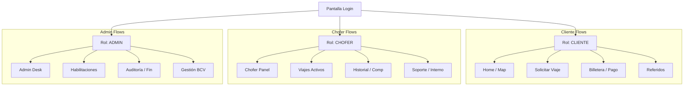

# XpressRides: Manual de Especificaciones Técnicas y Funcionales de Frontend

Este documento compila, analiza y formaliza las especificaciones funcionales, los requisitos de diseño de interfaz (UI/UX), los flujos de estado, el contrato de la API y los protocolos de contingencia necesarios para la construcción del frontend de la plataforma **XpressRides** (Proyecto Académico *Decarrerita* - UNEG, 2026).

Su objetivo principal es unificar el trabajo de desarrollo de la interfaz de **Manuel, Ángel y Freddy** con el desarrollo backend de **Johanna y Eliuber**, incorporando las decisiones de diseño tomadas el 20 de junio de 2026 y la estructura fiscal de facturación de Ciudad Guayana.

---

## 1. Identidad Visual y Guía de Estilo (UI/UX)

La interfaz de XpressRides debe proyectar una imagen que combine energía y dinamismo con confianza técnica y estabilidad financiera. Se implementará un diseño responsivo enfocado en dispositivos móviles (**Mobile-First**) utilizando la familia tipográfica **'Inter'** (con alternativas *Arial / Segoe UI*) y espaciados basados en múltiplos de **8 px**.

### 1.1 Paleta de Colores y Clases CSS Estándar

El equipo de diseño ha definido una paleta de colores cerrada. No se deben introducir colores personalizados para garantizar la consistencia visual.

| Nombre de Color | Código HEX | Elemento CSS / Uso | Qué transmite |
| :--- | :--- | :--- | :--- |
| **Naranja Xpress** | `#C55A11` | Botones principales (`.btn-primary`), logo, acentos y llamadas a la acción (CTA). | Energía, movimiento rápido. |
| **Azul Profundo** | `#1F4E79` | Barra de navegación superior, encabezados de tarjetas, texto de alta importancia. | Confianza, tecnología, orden. |
| **Azul Medio** | `#2E75B6` | Enlaces hipervínculo, iconos secundarios, estados focales de formularios. | Fluidez, interactividad. |
| **Gris Claro** | `#F5F5F5` | Fondo general de tarjetas (`.card`), filas de tablas de reportes, áreas neutras. | Limpieza, estructura limpia. |
| **Verde Confirmación** | `#1E6B3C` | Mensajes de éxito (`.alert-success`), saldo acreditado, viaje completado. | Aprobación, seguridad. |
| **Rojo Alerta** | `#C00000` | Mensajes de error (`.alert-error`), saldo insuficiente, botones SOS. | Atención inmediata, peligro. |

### 1.2 Reglas de Maquetación y CSS Compartido (`estilos.css`)

Para evitar inconsistencias visuales, **Manuel, Ángel y Freddy** utilizarán exclusivamente los siguientes componentes base definidos en el archivo global de estilos:

```css
/* FUENTE DEL SISTEMA */
body {
  font-family: 'Inter', -apple-system, 'Segoe UI', Arial, sans-serif;
  background-color: #FFFFFF;
  margin: 0;
  padding: 0;
}

/* COMPONENTES REUTILIZABLES */

/* Botón de acción principal */
.btn-primary {
  background-color: #C55A11;
  color: #FFFFFF;
  font-size: 16px;
  font-weight: 600;
  padding: 12px 24px;
  border-radius: 8px;
  border: none;
  cursor: pointer;
  transition: background-color 0.2s ease;
}

.btn-primary:hover {
  background-color: #A84A0A;
}

/* Botón de descarte o volver */
.btn-secondary {
  background-color: #FFFFFF;
  color: #1F4E79;
  border: 2px solid #1F4E79;
  font-size: 16px;
  font-weight: 600;
  padding: 10px 24px;
  border-radius: 8px;
  cursor: pointer;
  transition: background-color 0.2s ease;
}

.btn-secondary:hover {
  background-color: #F5F5F5;
}

/* Tarjeta estándar (Card) */
.card {
  background-color: #F5F5F5;
  border-radius: 12px;
  padding: 24px;
  box-shadow: 0 2px 8px rgba(0, 0, 0, 0.08);
}

/* Campos de entrada */
.input-field {
  border: 1px solid #CCCCCC;
  border-radius: 6px;
  padding: 10px 14px;
  font-size: 15px;
  font-family: 'Inter', sans-serif;
  width: 100%;
  box-sizing: border-box;
}

.input-field:focus {
  border-color: #2E75B6;
  outline: none;
}

/* Alertas de Estado */
.alert-success {
  background-color: #E2EFDA;
  color: #1E6B3C;
  border-left: 4px solid #1E6B3C;
  padding: 12px 16px;
  border-radius: 6px;
  font-weight: 500;
}

.alert-error {
  background-color: #FCE4D6;
  color: #C00000;
  border-left: 4px solid #C00000;
  padding: 12px 16px;
  border-radius: 6px;
  font-weight: 500;
}
```

### 1.3 Escala Tipográfica del Sistema

Toda pantalla del frontend de XpressRides debe apegarse estrictamente a la siguiente estructura tipográfica:

* **Título Principal (H1):** `28px` | Peso: `700` (Bold) (Ej. *"Solicitar Viaje"*).
* **Subtítulos (H2):** `20px` | Peso: `600` (Semibold) (Secciones internas).
* **Texto Normal (Cuerpo):** `15px` | Peso: `400` (Regular) (Instrucciones y descripciones).
* **Texto Pequeño / Ayuda:** `13px` | Peso: `400` (Regular) (Notas al pie o indicaciones menores).
* **Destacados de Importancia:** `32px` | Peso: `700` (Bold) (Visualización de tarifas o saldo, ej. *"$4.06 USD"*).

### 1.4 Reglas de Espaciado y Estructuración (Múltiplos de 8 px)

Para mantener un orden visual limpio y predecible, los márgenes (`margin`) y rellenos (`padding`) se estructurarán bajo el estándar del manual de diseño:

* **XS (4 px):** Separación de un icono de su texto complementario.
* **sm (8 px):** Espacio entre elementos íntimamente relacionados.
* **md (16 px):** Espacio estándar entre campos de formulario contiguos.
* **lg (24 px):** Margen interior de tarjetas e interlineado de bloques.
* **xl (32 px):** Distancia de separación entre bloques mayores.
* **xxl (48 px):** Margen de cabecera y pie de página de la vista completa.

---

## 2. Estructura de Navegación y Vistas (Sitemap del Frontend)

La aplicación implementará una navegación condicionada al rol del usuario autenticado (**CLIENTE, CHOFER, ADMINISTRADOR**).



---

## 3. Especificaciones de Pantallas: Flujos del Cliente

### 3.1 Pantalla Principal / Dashboard del Cliente

Punto de partida del usuario tras iniciar sesión. Debe renderizar un mapa interactivo (utilizando la librería offline **Leaflet.js** por acuerdo de la minuta del 18 de junio de 2026) que contiene los marcadores de las **40 zonas reales de Ciudad Guayana**.

#### Componentes Clave de la UI:

1. **Header de Usuario:**
   * Nombre del cliente (ej. *Johanna Guedez*).
   * Insignia de rango dinámico (*Platino*) calculada en base a su experiencia acumulada (ej. *5.00 Platino*).
   * **Campanita de Notificaciones:** Icono superior derecho de campana con burbuja de conteo de mensajes no leídos (ej. `[3]`). Al pulsarlo, despliega un panel lateral con los avisos automáticos del backend (*"Chofer asignado"*, *"Factura N° 30803524 emitida"*, etc.).
2. **Widget de Tasa de Cambio Activa:**
   * Muestra de forma prominente la tasa BCV del día (ej. *Bs. 582.69 >*). Al hacer clic, despliega una modal indicando: *"Tasa de cambio de acuerdo al Banco Central de Venezuela"*, permitiendo alternar de forma global la vista del dinero entre USD ($) y VES (Bs.).
3. **Selector de Servicios Rápidos:**
   * Mosaico de tarjetas con accesos directos:
     * **Viajes:** *"Viaja rápido y seguro"*.
     * **Envíos:** *"Manda lo que quieras"*.
     * **Comida:** *"Pide fácil y rápido"*.
     * **Marketplace:** *"Compra y vende de todo"* (Etiqueta *"NUEVO"* en color verde).
4. **Botón de Acción Flotante (Explorar Mapa):**
   * Acceso rápido a pantalla completa del mapa con buscador de dirección superior.
5. **Banner Promocional Dinámico:**
   * Información sobre campañas vigentes (ej. *"Yummy Prime: Prueba 30 días Gratis"*, *"Mundial Betfine: $5 de regalo"* o *"10% OFF + 2x Puntos + $0 en envíos"*).
6. **Barra de Navegación Inferior (Persistent Bottom Nav):**
   * Inicio | Historial | Agendados | Más (Menú lateral).

### 3.2 Flujo de Solicitud de Viaje (Paso a Paso)

Este flujo transforma la selección geográfica del cliente en una orden de traslado válida.

#### Paso 1: Configuración de Ruta
* **Inputs de Origen y Destino:** Campos `.input-field` de autocompletado enlazados estrictamente al catálogo de 40 zonas de Ciudad Guayana en la base de datos para evitar errores de geolocalización de APIs externas.
* **Selector de Paradas Rápidas:** Tarjetas `.card` preconfiguradas de uso frecuente (*Casa* con dirección grabada, *Trabajo* con dirección grabada, ej. *Av. Atlántico, Uneg, Caroní*).

#### Paso 2: Cálculo de Tarifas y Muestra del Menú de Servicios
Al definir el origen y el destino, el sistema invoca al backend para calcular la tarifa a través del **Algoritmo Híbrido Dinámico** y el frontend renderiza el menú de opciones de viaje:

> **Express (Auto Ligero)**  
> **$3.03** ~~$8.00~~ `[Primer viaje gratis]`  
> *"Precio Garantizado"*  
>
> **Cuádralo (Tú pones el precio)**  
> **$7.23** `[Descuento PRIME Activo]`  
>
> **Motto (Mototaxi)**  
> **$0.00** ~~$3.05~~ `[Primer viaje gratis]`  

##### Lógica de Renderizado de Cupones/Beneficios en Tarifa:
* Si el cliente tiene el beneficio de **Estudiante Universitario** y el destino coincide con una de las sedes de la **UNEG** o **UNEXPO**, el frontend debe aplicar visualmente el indicador de descuento del **30%** (ej. *"Descuento Estudiantil Aplicado"*).
* Si es el **Primer Viaje** del cliente y la distancia calculada por la función Haversine es **≤ 15 km**, se debe tachar el precio original, colocar `$0.00` y mostrar el tag animado `[Primer viaje gratis]`.
* **Conversión a Bs.:** Al lado del monto en USD, se debe mostrar de forma sutil su equivalente en bolívares calculados según la tasa del día (ej. `$1.00 / 607.39 Bs.`).

#### Paso 3: Selección de Método de Pago y Balance Check
* Antes de habilitar el botón *"Confirmar"*, el frontend debe evaluar la condición de saldo disponible:
  $$\text{Saldo Disponible (USD)} \ge \text{Costo del Viaje (USD)}$$
* Si el saldo es insuficiente, el botón principal cambia a color rojo (`#C00000`) y muestra el texto **"Recargar Saldo"**, redirigiendo al flujo de pagos.
* Si el saldo es suficiente, el cliente puede seleccionar el método de pago: *Saldo Recargado (Pago Móvil / Transferencia previamente aprobada)*.

### 3.3 Pantalla de Emparejamiento (Matchmaking)

Al presionar "Confirmar Viaje", el cliente ingresa a un estado de espera transitorio.

* **UI Elements:**
  * Animación de radar o círculos concéntricos en el mapa sobre su punto de partida.
  * Leyenda informativa: *"Buscando conductores... Este proceso puede demorar unos minutos"*.
  * **Temporizador de Aceptación:** Cuenta regresiva visual de **30 segundos** por cada intento de asignación de chofer que realiza el backend.
  * **Cancelación del Flujo:** Un botón *"Cancelar solicitud"* visible durante este proceso que cancela la petición en el backend antes de que un chofer acepte.

### 3.4 Pantalla de Viaje Activo (Seguimiento)

Una vez que el chofer acepta la solicitud, la vista cambia automáticamente al modo de seguimiento en tiempo real.

```
+-------------------------------------------------------------+
| [Foto Chofer] Vixenia Vanessa ★ 4.8                         |
|               Citroen C3 - Gris (Placa: FB170Z)             |
|-------------------------------------------------------------|
| Estado actual: "El conductor está llegando"                 |
| Tiempo estimado de recogida: 1:30 p.m.                      |
|-------------------------------------------------------------|
| [Llamar]            [Mensaje WhatsApp]          [Compartir] |
+-------------------------------------------------------------+
```

#### Secciones Críticas de la UI de Viaje Activo:

1. **Ficha Informativa de Seguridad del Vehículo:**
   * Debe mostrar claramente la foto del chofer, nombre de pila, calificación de estrellas (ej. *Santos Daniel, ★ 5.0*).
   * Modelo, marca, color y número de placa del vehículo asignado en letras grandes y contrastadas (ej. *CHEVROLET OPTRA GRIS - AD811ZV*).
2. **Línea de Tiempo del Estado de Traslado (Timeline):**
   * Indicador visual que se actualiza dinámicamente según el estado provisto por el backend:  
     $$\text{Asignado} \rightarrow \text{En Camino} \rightarrow \text{Llegó al Punto} \rightarrow \text{Viaje en Progreso} \rightarrow \text{Completado}$$
3. **Botón de Emergencia (SOS):**
   * Botón rojo flotante permanente en el mapa. Al ser presionado, levanta una confirmación con un solo clic para realizar llamadas de auxilio o compartir coordenadas de seguridad.
4. **Banda de Cobertura de Accidentes:**
   * Banner informativo: *"Todos tus viajes tienen cobertura de accidentes personales + $1000 en gastos médicos"*.
5. **Enlaces Directos de Comunicación de Contingencia (Fuera de la App):**
   * El frontend debe renderizar un botón de llamada directa (`tel:`) y un botón de enlace a WhatsApp (`https://wa.me/telefono_chofer?text=Hola...`) precargado para permitir la coordinación directa en caso de problemas de red.

### 3.5 Pantalla de Historial de Viajes y Descarga de Factura Fiscal

En esta pantalla, el cliente consulta la lista de viajes realizados. Por políticas de la sesión de diseño del 20 de junio, cada fila de viaje completado cuenta con un botón interactivo **"Ver Factura"**. Al accionarlo, se despliega una modal maquetada con precisión fiscal venezolana.

#### Maquetación del Modal "Factura Fiscal de XpressRides"

* **Estilo del Contenedor de Factura:** Fondo totalmente blanco, fuentes de ancho fijo (`monospace`) para la sección de montos, bordes sutiles y botones superiores de *"Imprimir"* o *"Cerrar"*.

```text
+-----------------------------------------------------------------------------+
|                              XpressRides, C.A.                              |
|                              RIF: J-50301732-5                              |
|                       Domicilio Fiscal: Ciudad Guayana                      |
|                                                                             |
| Factura                                    Nro. CONTROL: 00-3524            |
| Nro. Documento: 30803524                   Serie: D                         |
| Fecha de Emisión: 19/06/2026               Condición: Inmediata             |
| Tasa de Cambio (BCV): Bs. 607.3919         Moneda Base: USD ($)             |
|-----------------------------------------------------------------------------|
| Cliente: Dayana Guédez                                                      |
| RIF/CI: V-14089810                                                          |
| Domicilio: Calle 3, Caroní, Ciudad Guayana                                  |
|-----------------------------------------------------------------------------|
| CÓDIGO      DESCRIPCIÓN             Cant  P. UNIT   ALIC  DSCTO     MONTO   |
| RID-02-005  Traslado Urbano (Havers) 1     $3.51     0%   $0.00     $3.51   |
|-----------------------------------------------------------------------------|
|                                            Bolívares (Bs)    Dólares ($)    |
| Descuento:                                 Bs. 0,00          $0.00          |
| Base Exenta Cuenta de Terceros:            Bs. 2.131,95      $3.51          |
| Subtotal Factura:                          Bs. 2.131,95      $3.51          |
| Recargo IGTF (3,00% Divisas):              Bs. 63,95         $0.11          |
| TOTAL A PAGAR:                             Bs. 2.195,90      $3.62          |
|-----------------------------------------------------------------------------|
| * Este documento se expresa en Bolívares con su equivalencia en divisas     |
|   al tipo de cambio corriente oficial del BCV a la fecha de emisión.        |
| * IGTF del 3% aplica exclusivamente para pagos registrados en divisas.      |
+-----------------------------------------------------------------------------+
```

### 3.6 Pantalla de Referidos y Códigos Promocionales

* **Código de Referencia Único:** Presentación en bloque con botón de copiar al portapapeles (`document.execCommand('copy')`).
* **Reglas visuales explicadas:**
  * *"Comparte tu código con amigos y gana cupones de hasta $5 de descuento por viaje, con un pago mínimo de al menos $1 tras su primer traslado."*
  * *"Expiración de 7 días, válido para 1 uso."*
* **Cajón de Cupones Disponibles (Cupones Activos):** Listado de cupones con código, descuento y botón para aplicar directamente al viaje actual.

---

## 4. Especificaciones de Pantallas: Flujos del Conductor

### 4.1 Panel Principal del Chofer (Dashboard de Conducción)

Esta vista es la oficina virtual del conductor de XpressRides.

#### Componentes Clave:

1. **Header de Conductor:**
   * Nombre del chofer (ej. *Vixenia Vanessa*).
   * **Campanita de Notificaciones:** Mismo icono de alerta de notificaciones que el cliente, notificando asignaciones canceladas por terceros o liquidaciones de pagos.
2. **Toggle de Disponibilidad:**
   * Interruptor deslizante (*Toggle Switch*) en la parte superior derecha: `[ En Línea / Fuera de Línea ]`. Al activarse, cambia a color verde y notifica al backend que el chofer está listo para recibir viajes en un radio de 5 km.
3. **Visualización de Calificación y Progreso:**
   * Insignia de nivel (*Platino, Oro*) con barra de progreso de experiencia acumulada (ej. *65% de Exp: 10126 / 25800*).
   * Puntuación numérica grande (ej. *★ 5.00*).
4. **Métricas Rápidas:**
   * Viajes Totales (ej. *27 viajes*).
   * **Saldo Acumulado Pendiente de Cobro:** Visualización clara en USD y conversión dinámica a Bs. (ej. *5,327 Tokens* o *$35.00 USD*).
5. **Banner de Reclutamiento / Conducción:**
   * *"Postúlate como conductor de Rides. Gana desde $200 semanales"*.

### 4.2 Modal de Invitación de Viaje (Overlay de Asignación)

* **Comportamiento UI:** Interrumpe cualquier acción en el teléfono del chofer con un sonido de alerta característico.
* **Visualización de Datos:** Muestra zona de origen (recogida), zona de destino, distancia en kilómetros calcula con Haversine y ganancia neta para el chofer (70% de la tarifa).
* **Temporizador Visual de Aceptación:** Un círculo de progreso que se agota visualmente en **30 segundos**. Tiene dos botones gigantes de fácil acceso táctil: **[ ACEPTAR ]** (Verde) y **[ RECHAZAR ]** (Gris).

### 4.3 Panel de Control del Viaje en Progreso

El chofer interactúa con un único botón de estado grande y centrado en la parte inferior de la pantalla para reportar su progreso al backend.

```
+-------------------------------------------------------------+
| Estado del Viaje: EN CAMINO                                 |
|-------------------------------------------------------------|
|             [ DESLIZAR PARA CONFIRMAR LLEGADA ]             |
+-------------------------------------------------------------+
```

#### Lógica de Transición del Botón Principal:
* **Estado 1:** *"Confirmar Llegada al Origen"* (Deslizar para evitar clics accidentales).
* **Estado 2:** *"Iniciar Viaje"* (Al subir al pasajero).
* **Estado 3:** *"Completar Viaje"* (Al llegar a la zona de destino).

---

## 5. Panel de Administración (Backoffice UI)

La interfaz web del personal administrativo debe centrarse en la visualización ordenada de datos estructurados, tablas de auditoría y controles de validación.

### 5.1 Escritorio de Habilitación de Choferes (Proceso en 2 Etapas)

* **Etapa 1 (Lectura de Solicitudes):** Tabla con choferes en estado No Habilitado. Permite hacer clic en un chofer para abrir su ficha detallada de registro (datos personales y vehículo cargado).
* **Etapa 2 (Carga de Aprobaciones Administrativas):**
  * **Formulario de Verificación Psicológica:** Input numérico para nota de examen psicológico (el frontend valida que la nota ingresada sea un entero $\in [0, 100]$).
  * **Formulario de Revisión Técnica del Vehículo:** Input numérico para nota de revisión mecánica (entero $\in [0, 100]$) y selector de fecha de inspección.
  * **Carga de Datos Bancarios:** Inputs para selección de Banco Nacional y Número de Cuenta para pagos semanales.
  * **Cálculo Automático de Estado:** El frontend evalúa instantáneamente las notas ingresadas frente a las reglas de negocio:
    $$\text{Habilitado} = (\text{Examen Psicológico} \ge 73) \land (\text{Revisión Vehículo} \ge 65)$$
    Si cumple ambas, muestra un indicador de éxito en verde: **APTO PARA CONDUCTOR** y activa el botón "Habilitar Cuenta".

### 5.2 Módulo Financiero de Control 70/30

* **Auditoría de Pagos Pendientes:** Tabla que lista a los choferes y su saldo acumulado por viajes completados que aún no ha sido pagado por la empresa.
* **Registrar Pago de Nómina:** Formulario para registrar las transferencias realizadas a los conductores:
  * Campos: Monto (USD), Equivalente Bs, Banco emisor, Referencia bancaria, Fecha de pago.
  * Al guardar, actualiza dinámicamente el saldo del conductor en pantalla.
* **Visualización de Ganancias de la Empresa:** Filtro por rango de fechas que calcula de manera instantánea las sumas de las comisiones del **30%** retenidas por traslados, mostrando la métrica consolidada en USD y Bs. simultáneamente.

---

## 6. Gestión de Estados Críticos y Casos de Borde (Edge Cases)

Basándonos en la investigación de campo en Ciudad Guayana y las fallas registradas de la app de referencia, el frontend de XpressRides debe implementar estrategias robustas para los siguientes escenarios críticos:

### 6.1 Inestabilidad extrema de Red Móvil en Alta Vista (Movistar vs. Digitel)

* **El Problema:** La antena de Movistar presenta interrupciones severas de datos en áreas de Alta Vista, impidiendo que la aplicación reporte al servidor de mapas la ubicación de destino exacta en tiempo real para cerrar el viaje de forma automatizada.
* **Estrategia de Frontend (Resiliencia de Red):**
  * **Detección de Timeout:** Si una llamada al API para actualizar el estado del viaje (*Iniciar Viaje* o *Completar Viaje*) falla por más de 10 segundos, el frontend no debe bloquearse ni mostrar un crash de sistema.
  * **Modal de Alerta de Conectividad Activa:** Se debe desplegar un banner superior amigable: *"Conexión de datos inestable detectada. Estamos reintentando registrar el evento en segundo plano."*
  * **Sincronización por Cola local (Local queue):** Los cambios de estado realizados por el chofer se guardan con su timestamp exacto en la memoria de la aplicación (`localStorage` o similar de forma temporal) y se sincronizan automáticamente tan pronto como la conexión se restablezca.
  * **Recomendación de contingencia en pantalla:** En la misma modal de alerta, sugerir al chofer: *"Si la señal de Movistar es deficiente, te recomendamos compartir datos con un cliente Digitel para finalizar la transacción o usar el canal de Soporte."*

```text
+--------------------------------------------+
| ¿Problemas de conexión en Alta Vista?      |
|--------------------------------------------|
| La señal de Movistar suele presentar fallas|
| en esta zona. Sugerencias:                 |
| 1. Comparte datos vía Wifi de un           |
|    dispositivo Digitel.                    |
| 2. Usa el botón "Cierre de Soporte".       |
+--------------------------------------------+
```

### 6.2 Bloqueo de Viaje en Estado "Incompleto" (Botón de Soporte/Bot de Contingencia)

* **El Problema:** Al fallar el GPS, la aplicación no reconoce que el chofer y el cliente llegaron físicamente al destino, impidiendo que ambas apps salgan de la pantalla de viaje activo y quedando bloqueadas en un bucle infinito de "viaje incompleto".
* **Estrategia de Frontend:**
  * **Botón de Cierre Forzado Administrativo (Simulación de Bot):** En el panel del chofer, si el viaje lleva activo un tiempo que supere el promedio estimado en más de 20 minutos, se debe habilitar un botón de **"Reportar Incidente / Solicitar Cierre de Soporte"**.
  * **Lógica de Intervención:** Al ser presionado, se simula la acción del bot administrativo del backend que fuerza el estado del viaje a `Completado_Administrativo`. El frontend del chofer y del cliente recibe de forma inmediata la actualización de estado por websocket o polling corto, desbloquea las pantallas de viaje activo, limpia las variables de estado y redirige al cliente directamente a la pantalla de **Calificación del Conductor** de forma retroactiva.

### 6.3 Desajuste de Base de Datos de Vehículos Inspeccionados

* **El Problema:** Un chofer aprobado cambia de carro, pero la base de datos aún tiene registrado su carro viejo, lo cual es causal de penalización por políticas de seguridad del sistema.
* **Estrategia de Frontend:**
  * **Bloqueo de Estado "En Línea":** Si la fecha de la última revisión técnica del vehículo del conductor asociada a su perfil es mayor a un año, o si el chofer cambia el ID de su vehículo activo en su perfil, el toggle Switch de `[ En Línea ]` se debe bloquear automáticamente en color gris.
  * **UI Alert en el Dashboard del Chofer:** Mostrar un mensaje de alerta destacado en rojo: *"Se detectó un cambio de vehículo o tu revisión técnica anual ha expirado. Debes acudir a las oficinas de inspección en Unare para habilitar nuevamente tu cuenta."*

---

## 7. Contrato de Integración de API (Frontend - Backend)

El backend de **Johanna y Eliuber** requiere un formato estándar de respuesta en el que toda la información valiosa viaja dentro del nodo `"data"` si `"success"` es verdadero. El frontend de **Manuel, Ángel y Freddy** procesará de la siguiente manera:

### 7.1 GET `/api/tasa-bcv/vigente`

* **Descripción:** Retorna la tasa oficial BCV más reciente aplicando la lógica de proximidad histórica para fines de semana o feriados bancarios.
* **Respuesta JSON estándar:**

```json
{ 
  "success": true, 
  "data": { 
    "id": 142, 
    "tasaVes": 582.69, 
    "fechaVigencia": "2026-06-19" 
  }, 
  "message": "Tasa recuperada con éxito" 
}
```

### 7.2 POST `/api/traslados/calcular-tarifa`

* **Descripción:** Envía las zonas de origen y destino seleccionadas por el cliente junto con sus banderas de perfil para obtener el cálculo exacto de la tarifa.
* **Payload enviado:**

```json
{ 
  "clienteId": 12, 
  "zonaOrigenId": 5, 
  "zonaDestinoId": 18, 
  "nroPasajeros": 2 
}
```

* **Respuesta JSON estándar:**

```json
{ 
  "success": true, 
  "data": { 
    "distanciaKm": 6.8, 
    "tarifaBase": 1.00, 
    "costoDistancia": 3.06, 
    "recargoHoraPico": 0.81, 
    "recargoNocturnoFinSemana": 0.00, 
    "descuentoAplicado": 1.46, 
    "costoFinalUsd": 3.41, 
    "costoFinalVes": 1986.97, 
    "tasaBcvId": 142 
  }, 
  "message": "Cálculo de tarifa dinámico procesado exitosamente" 
}
```

### 7.3 POST `/api/traslados/solicitar`

* **Descripción:** Inicia el procedimiento almacenado transaccional en el backend para buscar un chofer por proximidad geográfica y asignarlo temporalmente.
* **Respuesta JSON estándar (Éxito de Asignación):**

```json
{ 
  "success": true, 
  "data": { 
    "trasladoId": 4022, 
    "estado": "ASIGNADO", 
    "chofer": { 
      "nombre": "Santos Daniel", 
      "telefono": "+584249367061", 
      "calificacion": 5.0, 
      "vehiculo": { 
        "marca": "Chevrolet", 
        "modelo": "Optra", 
        "color": "Gris", 
        "placa": "AD811ZV" 
      } 
    } 
  }, 
  "message": "Conductor emparejado y viaje asignado correctamente" 
}
```

### 7.4 GET `/api/notificaciones`

* **Descripción:** Retorna la lista de notificaciones no leídas correspondientes al usuario autenticado.
* **Respuesta JSON estándar:**

```json
{ 
  "success": true, 
  "data": [ 
    { 
      "id": 891, 
      "mensaje": "Tu factura N° 30803524 ha sido generada con éxito.", 
      "fechaHora": "2026-06-19T12:00:05", 
      "leido": false 
    }, 
    { 
      "id": 892, 
      "mensaje": "El chofer Santos Daniel ha iniciado el traslado.", 
      "fechaHora": "2026-06-19T11:53:10", 
      "leido": false 
    } 
  ], 
  "message": "Notificaciones recuperadas con éxito"
}
```

### 7.5 GET `/api/facturas/{trasladoId}`

* **Descripción:** Obtiene los datos fiscales del traslado para construir la modal de facturación interactiva.
* **Respuesta JSON estándar:**

```json
{ 
  "success": true, 
  "data": { 
    "facturaId": 1054, 
    "numeroDocumento": 30803524, 
    "control": "00-32992542", 
    "serie": "D", 
    "fechaEmision": "2026-06-19", 
    "horaEmision": "12:00:00", 
    "clienteNombre": "Dayana Guédez", 
    "clienteCedula": "V-14089810", 
    "clienteDireccion": "Calle 3, Caroní, Ciudad Guayana", 
    "costoUsd": 3.51, 
    "tasaVes": 607.3919, 
    "montoIgtfUsd": 0.11, 
    "totalUsd": 3.62, 
    "totalVes": 2195.90 
  }, 
  "message": "Factura fiscal recuperada con éxito" 
}
```

### 7.6 Mensaje de Error Típico (Ej. Saldo Insuficiente)

* **Descripción:** En caso de fallo de negocio, el backend responderá con código HTTP de error controlado y la siguiente estructura que el frontend debe renderizar usando la clase `.alert-error`:
* **Respuesta JSON estándar:**

```json
{ 
  "success": false, 
  "data": null, 
  "message": "Saldo insuficiente para realizar el traslado. Realiza un Pago Móvil para continuar." 
}
```

---

*Este manual garantiza que el frontend de **XpressRides** refleje exactamente la robustez operativa observada en el mercado real de transporte, cumpla los requerimientos académicos del proyecto Decarrerita y resulte en una experiencia de usuario impecable.*
